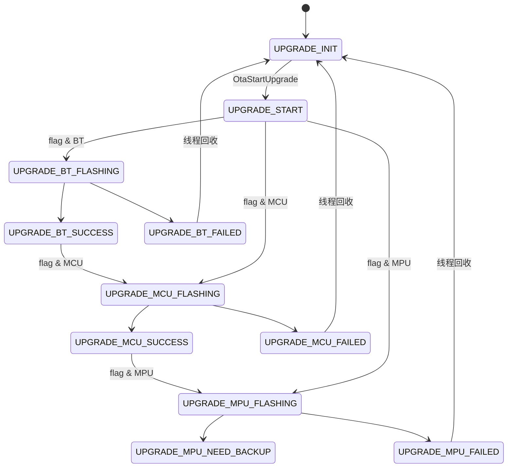
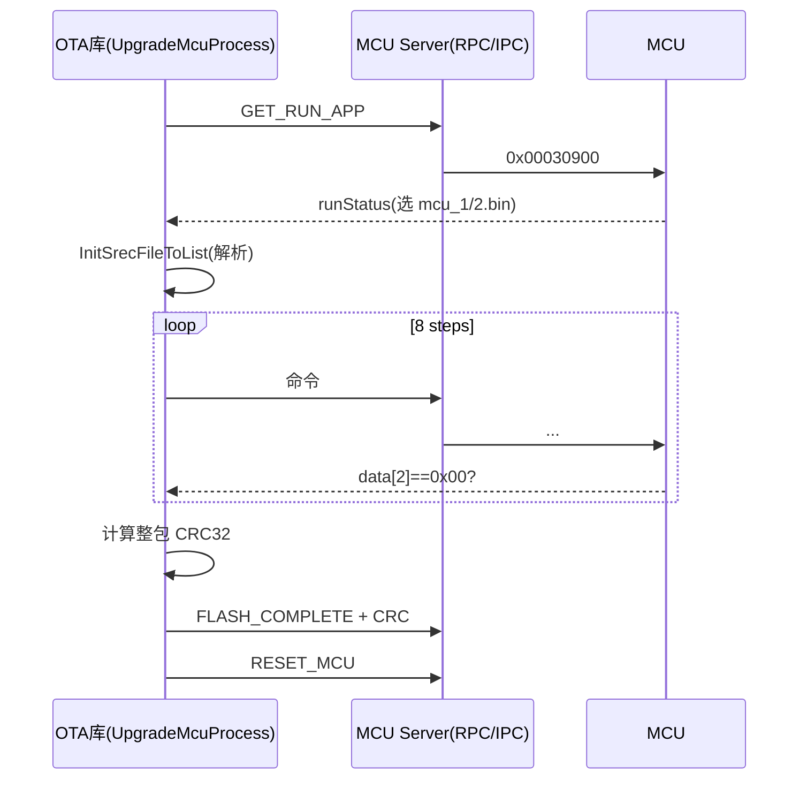

# OTA Demo 升级方式与内部升级逻辑分析

> 分析对象：`server/srsdk/demo/otademo/ota_demo.c`
> 关联实现：`server/srsdk/ota/`、`server/srsdk/mcu/`、`server/hal/modem/<MODEMTYPE>/`、`server/sripc/`
> 编译方式：`otaDemo` 只链接 `sr-sdk`（见 `demo/otademo/CMakeLists.txt`），因此 Demo 是 OTA SDK 的最小调用示例。

---

## 1. 概述

`ota_demo.c` 是一个命令行 Demo，用于触发并观察 MCU / MPU / BT 三个部件的升级过程。它本身不实现任何升级协议，只做三件事：

1. 初始化进程内的 IPC 消息接收线程（升级 MCU/BT 依赖 IPC 回调，见下文）。
2. 调用 `OtaStartUpgrade()` 异步启动升级线程。
3. 循环调用 `OtaGetUpgradeStatus()` 轮询状态，根据状态退出循环，必要时切换 MPU 的 A/B 分区。

真正的升级逻辑位于 `server/srsdk/ota/src/`：

| 文件 | 职责 |
| --- | --- |
| `ota_api.c` | 对外 API、升级线程调度、状态机、共享内存互斥、并发升级接口 |
| `ota_upgrade_mcu.c` | MCU 升级状态机（SREC 文件 + IPC 命令） |
| `ota_upgrade_bt.c` | BT 升级状态机（BIN 文件 + IPC 命令） |
| `ota_srec_parser.c` | MCU 升级包（SREC/S3）解析、地址/长度/CRC 计算、分片读取 |
| `ota_bin_parser.c` | BT 升级包（原始 BIN）解析、长度/CRC 计算、分片读取 |
| `ota_crc32.c` | 标准 CRC32（init `0xFFFFFFFF`，final 异或 `0xFFFFFFFF`） |
| `hal/modem/<MODEMTYPE>/hal_modem_upgrade.c` | MPU（模组 FOTA）升级：调用脚本 + `fotainfo`/`ab_full_update` |
| `srsdk/mcu/src/mcu_api.c` | 通过 RPC 把升级命令发给 MCU Server，最终下发到 MCU/BT |

---

## 2. 对外接口与枚举

### 2.1 升级标志 `UpgradeFlag_E`（`ota_api.h:30`）

| 值 | 枚举 | 含义 |
| --- | --- | --- |
| 1 | `UPGRADE_MCU_FLAG` | 升级 MCU |
| 2 | `UPGRADE_MPU_FLAG` | 升级 MPU |
| 3 | `UPGRADE_ALL_FLAG` / `UPGRADE_MPU_MCU_FLAG` | MCU + MPU |
| 4 | `UPGRADE_BT_FLAG` | 升级 BT |
| 5 | `UPGRADE_BT_MCU_FLAG` | BT + MCU |
| 6 | `UPGRADE_BT_MPU_FLAG` | BT + MPU |
| 7 | `UPGRADE_BT_MCU_MPU_FLAG` | BT + MCU + MPU |

标志是**位掩码**：`ota_api.c` 中用 `upgradeFlag & UPGRADE_MCU_FLAG` / `& UPGRADE_MPU_FLAG` / `& UPGRADE_BT_FLAG` 判断，因此 `UPGRADE_MPU_FLAG`(2) 与 `UPGRADE_ALL_FLAG`(3) 都能命中 MPU 分支。注意 `UPGRADE_BT_FLAG`(4) 与其它位不冲突。

### 2.2 升级状态 `UpgradeStatus_E`（`ota_api.h:13`）

| 值 | 枚举 | 含义 |
| --- | --- | --- |
| 0 | `UPGRADE_INIT` | 空闲/初始 |
| 1 | `UPGRADE_START` | 升级线程已启动 |
| 2 | `UPGRADE_MCU_FLASHING` | MCU 升级中 |
| 3 | `UPGRADE_MCU_SUCCESS` | MCU 升级成功 |
| 4 | `UPGRADE_MCU_FAILED` | MCU 升级失败 |
| 5 | `UPGRADE_MPU_FLASHING` | MPU 升级中 |
| 6 | `UPGRADE_MPU_NEED_BACKUP` | MPU 刷写完成，等待切分区/重启 |
| 7 | `UPGRADE_MPU_BACKUP` | MPU 备份中 |
| 8 | `UPGRADE_MPU_FAILED` | MPU 升级失败 |
| 9 | `UPGRADE_MPU_SUCCESS` | MPU 升级成功 |
| 10 | `UPGRADE_BT_FLASHING` | BT 升级中 |
| 11 | `UPGRADE_BT_SUCCESS` | BT 升级成功 |
| 12 | `UPGRADE_BT_FAILED` | BT 升级失败 |
| 13 | `UPGRADE_IS_BUSY` | 已有升级任务占用 |

### 2.3 对外 API（`ota_api.h`）

| 函数 | 说明 |
| --- | --- |
| `OtaStartUpgrade(path, flag)` | 异步启动升级，立即返回；真正执行在内部 `GThread` |
| `OtaGetUpgradeStatus(path, &status)` | 读取当前状态，并负责回收已结束的升级线程 |
| `OtaSwitchAOrBPartition()` | 仅在状态为 `UPGRADE_MPU_NEED_BACKUP` 时切换分区（内部即 `HalModemSwitch()`→`reboot`） |
| `OtaSwitchAOrBPartition2()` | 无条件执行 `HalModemSwitch()` |
| `SrTboxSystemReboot(appName, event)` | 延时 `reboot` |
| `ConcurrentOta*` | 与原始接口完全独立的并发升级接口（MCU 与 MPU 可并行） |

---

## 3. Demo 主流程解析

### 3.1 命令行参数

```c
if(argc < 2) ...
if(atoi(argv[1]) < UPGRADE_MCU_FLAG || atoi(argv[1]) > UPGRADE_BT_FLAG) ...
```

Demo 只接受 `1..4`：

| `argv[1]` | 实际 flag | 行为 |
| --- | --- | --- |
| 1 | `UPGRADE_MCU_FLAG` | 只升级 MCU |
| 2 | `UPGRADE_MPU_FLAG` | 只升级 MPU |
| 3 | `UPGRADE_ALL_FLAG` | 升级 MCU + MPU |
| 4 | `UPGRADE_BT_FLAG` | 只升级 BT |

> 说明：SDK 支持的组合（5/6/7，即包含 BT 的组合）Demo 未开放，但库本身支持。

升级包目录固定为 `"/oemdata/upgrade/"`（`ota_demo.c:53`）。

### 3.2 主流程图

```mermaid
flowchart TD
    A["main(argc, argv)"] --> B{"argc>=2 且 1<=argv[1]<=4"}
    B -- 否 --> B1["打印用法, 返回 -1"]
    B -- 是 --> C["StartQueueMsgRcvThread(\"upgrade\")\n初始化 IPC 接收线程"]
    C --> D["OtaStartUpgrade(\"/oemdata/upgrade/\", flag)\n异步启动升级线程"]
    D --> E["循环 OtaGetUpgradeStatus() 每秒轮询"]
    E --> F{"flag 判定退出条件"}
    F -- "MCU: SUCCESS/FAILED" --> G["退出循环"]
    F -- "BT: SUCCESS/FAILED" --> G
    F -- "含 MPU: FAILED" --> H["ql_cmd sysinfo /oemdata/log"] --> G
    F -- "含 MPU: NEED_BACKUP" --> G
    F -- 其它 --> I["sleep(1) 打印状态"] --> E
    G --> J{"状态 == UPGRADE_MPU_NEED_BACKUP?"}
    J -- 是 --> K["OtaSwitchAOrBPartition()\n(reboot 切分区)"]
    J -- 否 --> L["返回状态码 upgradeSta"]
    K --> L
```

### 3.3 逐点解析

1. `StartQueueMsgRcvThread("upgrade")`（`ota_demo.c:52`）
   - 初始化 IPC 共享内存与消息订阅线程。
   - **必须在 `OtaStartUpgrade` 之前调用**：`OtaStartUpgrade()` 内用 `ipcIsFirstCall()` 检查，如果 flag 含 MCU 或 BT 而 IPC 尚未初始化，会直接返回错误（`ota_api.c:355-365`）。
   - MCU/BT 升级过程依赖该线程把 MCU 回包分发给升级状态机注册的回调。

2. `OtaStartUpgrade("/oemdata/upgrade/", atoi(argv[1]))`（`ota_demo.c:53`）
   - 只做参数校验、MPU 状态校验、线程占用校验，然后创建 `UpgradeThreadFunc` 线程并立即返回，**不阻塞**。

3. 轮询循环（`ota_demo.c:56-92`）
   - 每秒调用 `OtaGetUpgradeStatus()`。
   - 退出条件按 flag 分别判断：
     - MCU（`flag==1`）：`MCU_SUCCESS` 或 `MCU_FAILED`。
     - BT（`flag==4`）：`BT_SUCCESS` 或 `BT_FAILED`。
     - 含 MPU（`flag & 2`）：`MPU_FAILED` 或 `MPU_NEED_BACKUP`。
   - `UPGRADE_MPU_FAILED` 时额外执行 `ql_cmd sysinfo /oemdata/log` 收集模组信息（`ota_demo.c:78-80`），便于现场定位。

4. 切分区（`ota_demo.c:94-97`）
   - 仅当最终状态为 `UPGRADE_MPU_NEED_BACKUP` 时调用 `OtaSwitchAOrBPartition()`。
   - 该接口内部判断状态后调用 `HalModemSwitch()`，对 AG591 即执行 `reboot`，通过重启完成 A/B 分区切换。
   - MCU/BT 升级不涉及切分区。

---

## 4. OTA 库内部升级逻辑（`ota_api.c`）

### 4.1 单例互斥：共享内存 + 进程间锁

OTA 库通过 POSIX 共享内存 `/otaLibShm`（`OtaLibShm_t`）做**跨进程**升级互斥：

- `OtaInitLibShm()`（`ota_api.c:53`）：`shm_open` + `mmap`，并只在首次创建时初始化一个 `PTHREAD_PROCESS_SHARED` 互斥量。
- `UpgradeTaskCreate()`（`ota_api.c:111`）：持锁检查 `pid` 字段，若已存在仍存活的持有者（`tkill(pid, 0) == 0`）则判定“升级中”，返回失败；否则记录当前线程 `tid`。
- `UpgradeTaskDestroy()`（`ota_api.c:153`）：释放占用，置 `pid = -1`。

因此即使多个进程（如 `otamodem1`、`otamodem2`、外部 App）同时调用 OTA 库，同一时刻也只有一个进程能真正跑升级。**注意：共享内存只做跨进程序列化，不做队列，后到者直接失败。**

### 4.2 升级线程 `UpgradeThreadFunc`（`ota_api.c:190`）

统一线程按固定顺序依次执行 **BT → MCU → MPU**，逐段推进状态，并在 MCU/BT 开始时通过 IPC 广播状态：

| 顺序 | 条件 | 起始状态 | 调用 | 成功状态 | 失败状态 |
| --- | --- | --- | --- | --- | --- |
| 1 | `flag & BT` | `UPGRADE_BT_FLASHING` | `UpgradeBtProcess(path)` | `UPGRADE_BT_SUCCESS` | `UPGRADE_BT_FAILED`（线程退出） |
| 2 | `flag & MCU` | `UPGRADE_MCU_FLASHING` | `UpgradeMcuProcess(path)` | `UPGRADE_MCU_SUCCESS` | `UPGRADE_MCU_FAILED`（线程退出） |
| 3 | `flag & MPU` | `UPGRADE_MPU_FLASHING` | `HalModemUpgradeImpl(path)` | `UPGRADE_MPU_NEED_BACKUP` | `UPGRADE_MPU_FAILED`（线程退出） |

- 任一阶段失败都会结束线程，**后续阶段不再执行**（例如 BT 失败则 MCU/MPU 不升级）。
- BT 起始状态会 `IpcSendUpgradeState()` 广播（`SYS_QUE_TYPE_SGMW_UPGRADE_STATUS_SYNC`，`queue_msg.h:109`），MCU 同样广播，MPU 只置本地状态。
- 全部完成且状态仍为 `UPGRADE_START` 时回退为 `UPGRADE_INIT`。

### 4.3 状态读取与线程回收 `OtaGetUpgradeStatus`（`ota_api.c:396`）

- 若 `g_UpgradeThread == NULL`（本进程没有活动升级线程）：直接查 `HalModemGetUpgradeStatus()`（即脚本 `get_upgrade_status.sh`），把 HAL 状态映射为：
  - `HAl_UPGRADE_MPU_FLASHING` → `UPGRADE_IS_BUSY`
  - `HAl_UPGRADE_MPU_OK` → `UPGRADE_MPU_SUCCESS`
  - `HAl_UPGRADE_MPU_FAILED` → `UPGRADE_MPU_FAILED`
  - `HAl_UPGRADE_MPU_BACKUPING` / `NEED_BACKUP` → `UPGRADE_MPU_BACKUP`
  - 其它（含成功 0）保留 `g_UpgradeStatus`
- 若线程存在：直接返回 `g_UpgradeStatus`，并在 **MCU/BT 成功或失败、MPU 失败**时 `g_thread_unref` 并置 `NULL`，使下一次查询回到“无本地线程”的 HAL 查询分支。
- 每次都会 `IpcSendUpgradeState()` 广播当前状态。

> 设计约束：`UPGRADE_MPU_NEED_BACKUP` 状态**不会被自动回收**，需要调用者显式调用 `OtaSwitchAOrBPartition()`（或重启）来完成闭环。

### 4.4 状态机



---

## 5. MCU 升级方式

**实现：`ota_upgrade_mcu.c`，升级文件为 SREC（Motorola S3）格式文本。**

### 5.1 升级包与文件选择

| 宏 | 值 | 说明 |
| --- | --- | --- |
| `OTA_MCU_APP1_NAME` | `mcu_1.bin` | A 区/默认区镜像 |
| `OTA_MCU_APP2_NAME` | `mcu_2.bin` | B 区镜像 |

文件位于 `"<filePath>mcu_1.bin"` / `"<filePath>mcu_2.bin"`。

选择依据 `UpgradeMcuRunAppReq()` 返回的 `mcuRunStatus`（`ota_upgrade_mcu.c:934-961`）：

- `0x01`：当前运行 B 区 → 升级 `mcu_2.bin`
- `0x00` 或 `0x02`：当前运行 A 区/其它 → 升级 `mcu_1.bin`
- 获取运行状态最多重试 3 次。

### 5.2 命令序列（状态机表 `g_upgradeMcuProcess`，`ota_upgrade_mcu.c:835`）

| step | 函数 | 下发消息类型（`queue_msg.h`） | 作用 |
| --- | --- | --- | --- |
| 0 | `UpgradeMcuGetVernReq` | `SYS_QUE_TYPE_MCU_UPGRADE_GET_VER` (0x00030100) | 获取版本 |
| 1 | `UpgradeMcuGetSeedReq` | `SYS_QUE_TYPE_MCU_UPGRADE_GET_SEED` (0x00030200) | 获取 Seed |
| 2 | `UpgradeMcuUnlockFlashReq` | `SYS_QUE_TYPE_MCU_UPGRADE_UNLOCK_FLASH` (0x00030300) | 解锁 Flash |
| 3 | `UpgradeMcuPutFlashReq` | `SYS_QUE_TYPE_MCU_UPGRADE_PUT_FLASHING` (0x00030400) | 进入下载模式 |
| 4 | `UpgradeMcuEraseFlashReq` | `SYS_QUE_TYPE_MCU_UPGRADE_ERASE_FLASH` (0x00030500) | 擦除 Flash（带起址+长度） |
| 5 | `UpgradeMcuFlashingReq` | `SYS_QUE_TYPE_MCU_UPGRADE_FLASH_MCU` (0x00030600) | 循环下发数据 |
| 6 | `UpgradeFlashCompleteReq` | `SYS_QUE_TYPE_MCU_UPGRADE_FLASH_COMPLETE` (0x00030700) | 下发整包 CRC32 |
| 7 | `UpgradeMcuRestMcuReq` | `SYS_QUE_TYPE_MCU_UPGRADE_RESET_MCU` (0x00030800) | 复位 MCU |

另有 `SYS_QUE_TYPE_MCU_UPGRADE_GET_RUN_APP` (0x00030900) 用于升级前的运行区判断。

### 5.3 报文约定

每次请求的数据以 2 字节计数器开头，MCU 回包第 3 字节（`data[2]`）为状态：`0x00` 成功，其它失败。

| 步骤 | 请求负载格式 |
| --- | --- |
| GetVer / GetSeed / GetRunApp | `[count_hi][count_lo]` |
| UnlockFlash | `[count_hi][count_lo][seed0..3]` |
| PutFlash | `[count_hi][count_lo][0x01 0x02 0x03 0x04]` |
| EraseFlash | `[count][魔数4B][startAddr 4B][fileLen 4B]` |
| Flashing | `[count][addr 4B][数据 512B]`，每次 516 字节 |
| FlashComplete | `[count][crc32 4B]` |
| Reset / RunApp | `[count][魔数4B]` |

> 备注：`UpgradeMcuGetSeedReq()` 中的 seed 目前是**硬编码的 `0x01 0x02 0x03 0x04`**（`ota_upgrade_mcu.c:209-212`），并未使用 MCU 返回的真实 Seed；`UpgradeMcuGetVernReq` 虽在订阅列表中，但不在升级流程表中被调用。

### 5.4 重试与握手

- 每条命令通过 `WaitUpgradeMcuMsgTimeOut()`（`g_cond_wait_until`，基于 `GTimeSpan`）等待 MCU 回包，超时 **3 秒**（`OTA_RECV_MCU_DATA_TIME_OUT`）。
- 回调 `SetRecvMcuDataToUpgradeMcuProcess()` 先比对 `msgType` 再落数据并 `g_cond_signal`，实现“同一类型消息才唤醒等待者”。
- 数据分片下发（`UpgradeMcuFlashingReq`）单包重试 **3 次**，成功后 `usleep(10ms)` 等 MCU 就绪。
- `UpgradeMcuProcess` 的外层重试逻辑（`ota_upgrade_mcu.c:965-991`）：
  - step 5（数据下发）成功时把 `whileCount=2`，不 break，继续读下一片；
  - 数据读尽时 `GetSrecFileContenLenFormList` 返回 0/负值 → 判定为失败 → 结束 step 5，进入 step 6（用“失败”作为数据结束信号）；
  - 其它 step：成功 → 进入下一步；失败 → `whileCount--` 重试，最多 3 次。

### 5.5 SREC 解析与 CRC（`ota_srec_parser.c`）

- `InitSrecFileToList()`：逐行读取，仅处理 `S3` 记录。
- 第一条 S3 记录的地址字段（第 5~8 个字符）作为 `startAddr`；`fileLen` 为所有数据段长度之和。
- 数据链表节点保存 `地址(4B)+数据`，`GetSrecFileContenLenFormList()` 按地址连续性拼装分片，地址跳变即终止。
- CRC：对每条 S3 记录的数据区（去掉地址和校验和）做增量 CRC32，`GetUpgradeSrecFileCrc()` 提供给 `FlashComplete`。
- 结束调用 `DestroyListAndFree()` 释放链表。



---

## 6. BT 升级方式

**实现：`ota_upgrade_bt.c`，升级文件为原始 BIN。**

### 6.1 升级包

| 宏 | 值 |
| --- | --- |
| `OTA_BT_APP1_NAME` | `bt_1.bin` |
| `OTA_BT_APP2_NAME` | `bt_2.bin`（代码中未使用） |

`UpgradeBtProcess()` 只处理 `btRunStatus == 0x00`，固定加载 `bt_1.bin`（`ota_upgrade_bt.c:636-649`）；`0x01`（B 区）分支未实现。

### 6.2 命令序列（`g_upgradeBtProcess`，`ota_upgrade_bt.c:544`）

| step | 函数 | 消息类型 | 作用 |
| --- | --- | --- | --- |
| 0 | `UpgradeBtEraseFlashReq` | `SYS_QUE_TYPE_BT_UPGRADE_ERASE_FLASH` (0x00030b00) | 擦除 Flash |
| 1 | `UpgradeBtFlashingReq` | `SYS_QUE_TYPE_BT_UPGRADE_FLASHING_BT` (0x00030c00) | 分片下发数据 |
| 2 | `UpgradeFlashCompleteReq` | `SYS_QUE_TYPE_BT_UPGRADE_FLASH_COMPLETE` (0x00030d00) | 下发整包 CRC32 |
| 3 | `UpgradeBtRestBtReq` | `SYS_QUE_TYPE_BT_UPGRADE_RESET_BT` (0x00030e00) | 复位 BT |

升级前通过 `SYS_QUE_TYPE_BT_UPGRADE_READY` (0x00030a00) 获取状态（`UpgradeBtRunAppReq`，回包读 `data[2]`）。

### 6.3 与 MCU 的差异

| 项 | MCU | BT |
| --- | --- | --- |
| 文件格式 | SREC（文本） | Raw BIN |
| 解析器 | `ota_srec_parser.c` | `ota_bin_parser.c`（512B/块） |
| 分片大小 | 512B 数据 + 4B 地址 = 516B | **240B** 数据（`OTA_SEND_BT_FLASH_DATA_LEN`） |
| 单包负载 | `[count][addr 4B][data]` | `[count][data]`（无地址） |
| 等待超时 | 3s | **2s**（`OTA_RECV_BT_DATA_TIME_OUT`） |
| 单包重试 | 3 次 | **5 次** |
| 步骤重试 | 3 次 | 3 次 |
| 读取进度 | 链表地址连续性校验 | 显式游标 `g_currentPos`/`g_currentOffset`，升级前 `ResetBinFileReadPosition()` |

BT 的 CRC 与 MCU 相同，均为整包 CRC32（`GetUpgradeBinFileCrc`）。

### 6.4 BIN 解析（`ota_bin_parser.c`）

- `InitBinFileToList()`：`fopen(..., "rb")`，每次 `fread` 512 字节存入链表节点，同时增量更新 CRC32 与总长。
- `GetBinFileContenLenFormList()`：按 `g_currentPos`/`g_currentOffset` 游标跨节点拼接，每次最多取 240B，读到链表尾返回 0。
- `ResetBinFileReadPosition()`：升级开始时复位游标，保证重试/再次升级从头读取。

---

## 7. MPU 升级方式

**实现：`hal/modem/<MODEMTYPE>/hal_modem_upgrade.c`（当前构建为 `MODEMTYPE=AG591`）。MPU 升级即模组的 FOTA，基于 A/B 双分区。**

### 7.1 与 MCU/BT 的本质区别

MCU/BT 走“MPU→IPC→MCU/BT”的命令流；MPU 本身就是当前 CPU/模组，升级方式是**调用脚本 + 模组侧 `fotainfo` / `ab_full_update` 工具刷写到备用分区，然后重启切分区**，不经过 MCU。

### 7.2 三个核心接口

| 接口 | 命令 | 说明 |
| --- | --- | --- |
| `HalModemUpgradeImpl(path)` | `sh /oemapp/scripts/start_upgrade_mpu.sh <path> <path>upgrade_mpu.log` | 执行升级脚本，脚本内部轮询直到成功/失败 |
| `HalModemGetUpgradeStatus(path)` | `sh /oemapp/scripts/get_upgrade_status.sh <path>` | 查询状态，返回码见下表 |
| `HalModemSwitch()` | `reboot` | 重启以切换 A/B 分区 |

### 7.3 HAL 状态码 `UpgradeMpuStatus_E`（`hal_modem_upgrade.h:12`）

| 值 | 枚举 | 含义 |
| --- | --- | --- |
| 0 | `HAl_UPGRADE_MPU_OK` | 成功 |
| 1 | `HAl_UPGRADE_MPU_FLASHING` | 升级中 |
| 2 | `HAl_UPGRADE_MPU_NEED_BACKUP` | 需备份（刷写完成，待切分区） |
| 3 | `HAl_UPGRADE_MPU_FAILED` | 失败 |
| 4 | `HAl_UPGRADE_MPU_BACKUPING` | 备份中 |
| 5 | `HAl_UPGRADE_MPU_NO_PATH` | 缺少升级包路径 |

### 7.4 `start_upgrade_mpu.sh` 逻辑

1. 参数校验（升级包路径 + 日志路径）。
2. `fotainfo --get-stat` 取当前状态：仅允许 `0`（成功/空闲）或 `3`（失败）时继续，否则 `exit 2`（不满足升级条件）。
3. `fotainfo -p <path>` 指定升级包，失败 `exit 3`。
4. `fotainfo -t 1` 设置打印/超时相关参数，失败 `exit 4`。
5. `ab_full_update "start-full-fota"` 启动整包 FOTA，失败 `exit 5`。
6. 循环 `fotainfo --get-stat` 直到状态变为 `2`（需备份，`exit 0`）或 `3`（失败，`exit 6`），其它情况 `exit 7`（状态错乱）。

返回码：`0 刷写成功 / 1 参数错误 / 2 不满足升级条件 / 3 路径错误 / 4 打印时间错误 / 5 执行升级指令失败 / 6 升级失败 / 7 状态错乱`。

### 7.5 `get_upgrade_status.sh` 逻辑

1. 若 `<path>/tmpupdate` 目录存在则 `backupFlag=1`。
2. 读 `fotainfo --get-stat` 状态。
3. `backupFlag==1 && status==2` → 返回 `4`（备份中）；否则直接返回 `status`。

### 7.6 MPU 升级闭环（结合 Demo）

```mermaid
sequenceDiagram
    participant APP as Demo/App
    participant OTA as OTA库
    participant HAL as hal_modem_upgrade
    participant FM as fotainfo/ab_full_update
    APP->>OTA: OtaStartUpgrade(path, UPGRADE_MPU_FLAG)
    OTA->>OTA: HalModemGetUpgradeStatus 预检(不允许FLASHING/NEED_BACKUP/NO_PATH)
    OTA->>HAL: HalModemUpgradeImpl(path)
    HAL->>FM: start_upgrade_mpu.sh → fotainfo -p / -t / ab_full_update
    FM-->>HAL: 写备用分区完成 (status=2)
    HAL-->>OTA: 返回 0
    OTA->>OTA: g_UpgradeStatus = UPGRADE_MPU_NEED_BACKUP
    APP->>OTA: 轮询到 NEED_BACKUP
    APP->>OTA: OtaSwitchAOrBPartition()
    OTA->>HAL: HalModemSwitch() → reboot
    Note over OTA,FM: 重启后新分区生效; 重启后 fotainfo 状态为成功
```

- `OtaStartUpgrade()` 在启动前会调用 `HalModemGetUpgradeStatus()` 预检，只要处于 `FLASHING/NEED_BACKUP/BACKUPING/NO_PATH` 均拒绝新升级（`ota_api.c:345-352`）。
- 脚本刷写成功后返回 `NEED_BACKUP`，Demo 据此调用 `OtaSwitchAOrBPartition()` → `reboot` 完成分区切换（AG591 的 `HalModemSwitch` 即直接 reboot）。
- `OtaSwitchAOrBPartition()` 只有在 `g_UpgradeStatus == UPGRADE_MPU_NEED_BACKUP` 时才真正执行切换，否则返回 `RET_ERR`。

---

## 8. 并发升级接口（`ConcurrentOta*`）

`ota_api.c:545` 起提供了与原始流程**完全独立**的一套上下文（`g_mcuConcurrentCtx` / `g_mpuConcurrentCtx`），允许 MCU 与 MPU 并行升级：

| 接口 | 说明 |
| --- | --- |
| `ConcurrentOtaStartUpgrade(path, flag)` | 按 flag 位分别创建 `mcu_concurrent` / `mpu_concurrent` 线程 |
| `ConcurrentOtaGetUpgradeStatus(path, &status, flag)` | 取指定模块状态；线程结束且非活动时返回 `UPGRADE_INIT` |
| `ConcurrentOtaGetAllUpgradeStatus(path, &mcu, &mpu)` | 原子读取两者；**MPU 状态优先取 `fotainfo --get-stat`** |
| `ConcurrentOtaStopUpgrade(flag)` | 把指定模块标记为 `UPGRADE_*_FAILED` 并清 `isActive` |

- MCU 线程直接调用 `UpgradeMcuProcess()`；MPU 线程调用 `HalModemUpgradeImpl()`。
- `GetFotainfoStatus()` 解析 `fotainfo --get-stat` 输出括号内的数字：`1→FLASHING`、`2→NEED_BACKUP`、`3→FAILED`。

> 并发接口不走共享内存互斥，与原始接口状态互不感知，实际使用时需由业务层保证不同时混用。

---

## 9. 升级文件与关键路径

| 项 | 路径/名称 |
| --- | --- |
| 升级目录（Demo 传参） | `/oemdata/upgrade/` |
| MPU 升级包 | `<dir>/update.zip`（`OTA_MPU_PATH_NAME`） |
| MCU 升级包 | `<dir>/mcu_1.bin`、`<dir>/mcu_2.bin`（SREC 文本） |
| BT 升级包 | `<dir>/bt_1.bin`（Raw BIN） |
| MPU 升级脚本 | `/oemapp/scripts/start_upgrade_mpu.sh` |
| MPU 状态脚本 | `/oemapp/scripts/get_upgrade_status.sh` |
| MPU 升级日志 | `upgrade_mpu.log` |
| 共享内存 | `/otaLibShm`（`OTA_SHM_PATH`） |

---

## 10. 关键代码索引

| 功能 | 位置 |
| --- | --- |
| Demo 入口/参数校验 | `server/srsdk/demo/otademo/ota_demo.c:35` |
| Demo 启动升级 | `ota_demo.c:52-54` |
| Demo 轮询与退出条件 | `ota_demo.c:56-92` |
| Demo 切分区 | `ota_demo.c:94-97` |
| 标志/状态枚举 | `server/srsdk/ota/inc/ota_api.h:13,30` |
| 共享内存互斥 | `server/srsdk/ota/src/ota_api.c:53,111,153` |
| 升级线程调度 | `ota_api.c:190`（BT 228 / MCU 252 / MPU 276） |
| `OtaStartUpgrade` | `ota_api.c:319` |
| `OtaGetUpgradeStatus` | `ota_api.c:396` |
| `OtaSwitchAOrBPartition` | `ota_api.c:485` |
| 并发升级 | `ota_api.c:678,735,762,787` |
| MCU 流程表/主流程 | `ota_upgrade_mcu.c:835,899` |
| MCU 分片下发 | `ota_upgrade_mcu.c:382` |
| BT 流程表/主流程 | `ota_upgrade_bt.c:544,596` |
| BT 分片下发 | `ota_upgrade_bt.c:188` |
| SREC 解析 | `ota_srec_parser.c:150,241,372` |
| BIN 解析 | `ota_bin_parser.c:91,159,290,377` |
| CRC32 | `ota_crc32.c:74-94` |
| MPU HAL（AG591） | `server/hal/modem/AG591/hal_modem_upgrade.c:47,73,95` |
| MPU 脚本 | `server/hal/modem/AG591/script/start_upgrade_mpu.sh`、`get_upgrade_status.sh` |
| 消息类型枚举 | `server/sripc/inc/queue_msg.h:59-72` |
| MCU IPC 发送 | `server/srsdk/mcu/src/mcu_api.c:7`（`McuSrvSendMesg`） |

---

## 11. 注意事项与风险点

1. **Demo 只开放 1~4**，`UPGRADE_BT_MCU_FLAG(5)`、`UPGRADE_BT_MPU_FLAG(6)`、`UPGRADE_BT_MCU_MPU_FLAG(7)` 需自行调用库接口。
2. **必须先初始化 IPC**：含 MCU/BT 的升级若未先 `StartQueueMsgRcvThread()`，`OtaStartUpgrade()` 会因 `ipcIsFirstCall()` 直接失败。
3. **MPU 成功不能只等状态**：`UPGRADE_MPU_NEED_BACKUP` 之后必须显式调用 `OtaSwitchAOrBPartition()`（触发 `reboot`），否则升级不闭环；该状态也不会被 `OtaGetUpgradeStatus` 自动回收线程。
4. **MCU Seed 为硬编码值**（`ota_upgrade_mcu.c:209`），`GET_VER` 步骤未纳入流程，安全性与版本校验需结合 MCU 侧确认。
5. **BT 只支持 `bt_1.bin` 分支**：`bt_2.bin` 与 `btRunStatus==0x01` 未实现。
6. **MPU/BT/MCU 升级包需预先放入 `/oemdata/upgrade/`**，路径长度上限 `UPGRADE_PATH_MAX_LEN = 128`。
7. **MPU 状态在“无本地线程”时来自脚本**，`fotainfo` 不可用或输出解析失败时状态可能不符预期；Demo 在 MPU 失败时通过 `ql_cmd sysinfo /oemdata/log` 采集信息。
8. **并发接口与原始接口互不感知**：不要在同一业务中混用 `Ota*` 与 `ConcurrentOta*`。
9. **升级失败顺序短路**：`UpgradeThreadFunc` 中 BT/MCU 任一失败即退出，后续部件不会升级；组合升级需关注该短路语义。