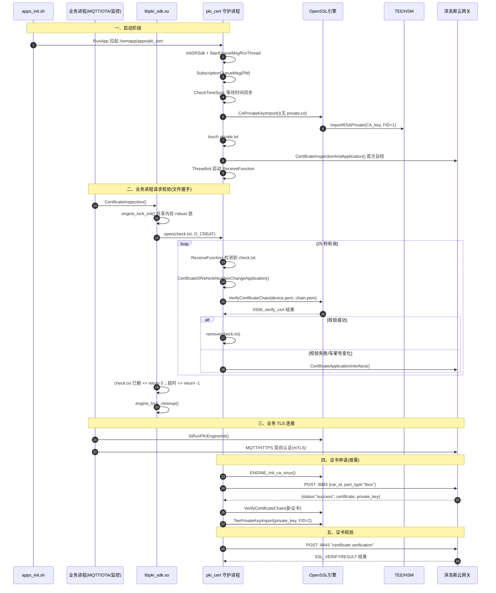

# PKI 证书/密钥校验 交互流程设计文档

> 适用代码路径：`src/mpu`
> 涉及模块：`app/pki_cert`、`app/pki_sdk_lib`、`server/srsdk/opensslengine`
> 相关服务：泽洛斯 TLS 网关 `tls-gateway.zelostech.com.cn`

---

## 1. 概述

本文描述 MPU 侧 PKI（Public Key Infrastructure）证书与密钥的申请、导入、校验、以及在 TLS 业务连接中的使用全链路。

系统的核心设计要点：

1. **进程分离**：`pki_cert` 是常驻守护进程，负责真正执行证书校验/申请/私钥导入；其他业务进程通过动态库 `libpki_sdk.so` 以「文件信号量」方式请求服务。
2. **文件信号量握手**：`/oemdata/cert/check.txt` 作为跨进程请求/完成信号；`/oemdata/cert/private.txt` 作为 CA 私钥已导入的标志。
3. **跨进程互斥**：通过共享内存 `/pki_engine_robust_mutex_shm` 上的 robust mutex，保证加密芯片（TEE/HSM）引擎同一时刻只被一个进程/线程使用。
4. **密钥不落明文**：私钥统一导入 TEE/HSM，由 OpenSSL 引擎 `engine-sirun`（客户端密钥）/`engine-sirun-ca`（CA 密钥）在签名/验签时调用。
5. **多层次校验**：X509 证书链离线校验 + 云端 TLS 双向认证在线校验 + 引擎内 RSA 验签。

---

## 2. 组成与文件映射

| 角色 | 主要文件 | 职责 |
|---|---|---|
| 守护进程入口 | `app/pki_cert/src/pki_sdk.cpp` | main、接收线程、PM 休眠处理 |
| 证书接口 | `app/pki_cert/src/openssl/certificate_interface.cpp` | 证书链校验、私钥导入、CN 校验 |
| HTTP 传输 | `app/pki_cert/src/https/https.cpp` | curl mTLS、SSL 上下文配置 |
| 流程编排 | `app/pki_cert/src/https/https_interface.cpp` | 自检/申请流程编排 |
| JSON 组包/解析 | `app/pki_cert/src/cjson/cjson_interface.cpp` | 申请报文、响应解析 |
| 系统接口 | `app/pki_cert/src/misc/system_interface.cpp` | 取车架号、时间同步、执行 shell |
| 文件接口 | `app/pki_cert/src/misc/file_interface.cpp` | 文件读写 |
| 线程接口 | `app/pki_cert/src/misc/thread_interface.cpp` | 线程创建 |
| SDK 动态库 | `app/pki_sdk_lib/src/pki_sdk.cpp` | 供业务进程调用的 `CertificateInspection()`、RSA 加解密 |
| 加密引擎 | `server/srsdk/opensslengine/src/sr_engine.c` | engine 注册、RSA 签名/验签、密钥加载 |
| 加密引擎(TEE) | `server/srsdk/opensslengine/src/sr_engine_tee.c` | TEE 版本签名/验签、密钥导入/删除 |
| 本地 CSR 服务 | `server/service/fty/src/fty_crt.c` | socket CSR 申请与密钥/证书模数比对 |
| 业务调用方 | `app/mqtt_proto`、`app/ota_config2`、`app/ota_configuration`、`app/remote_monitor` | 建 TLS 前调用 `CertificateInspection()` |

### 关键常量

`app/pki_cert/inc/misc/file_interface.h`

| 宏 | 值 | 说明 |
|---|---|---|
| `ROOTCACERTCHAINFILE` | `/oemapp/cert/certificate_chain_client.pem` | 根 CA 链（校验服务端） |
| `DEVICECACERTCHAINFILE` | `/oemapp/cert/certificate_chain.pem` | 设备证书链 |
| `DEVICECERTFILE` | `/oemdata/cert/device.pem` | 云端下发的设备证书 |
| `CERTFILE` | `/oemapp/cert/certificate.pem` | 申请证书时使用的客户端证书 |
| `KEYFILEFLAG` | `/oemdata/cert/private.txt` | CA 私钥已导入标志 |
| `FILE_CHECK` | `/oemdata/cert/check.txt` | 跨进程校验握手信号 |

`app/pki_cert/inc/https/https.h`

| 宏 | 值 |
|---|---|
| `CERTVERIFICATIONLINK` | `https://tls-gateway.zelostech.com.cn:8443` |
| `CERTIFICATEAPPLICATIONLINK` | `https://tls-gateway.zelostech.com.cn:8083/api/v1/tls_info_create` |
| `HEADER` | `Content-Type: application/json` |

`server/srsdk/opensslengine/inc/sr_engine.h`（TEE 模式）

| 宏 | 值 | 说明 |
|---|---|---|
| `ENGID` | `engine-sirun` | 客户端密钥引擎 |
| `CAENGID` | `engine-sirun-ca` | CA 密钥引擎 |
| `CA_KEY` / `PRI_FID_01` | `1` | CA 私钥 FID |
| `CLIENT_KEY` / `PRI_FID_02` | `2` | 客户端私钥 FID |
| `HSMTYPE_TEE` | 已定义 | 走 TEE 实现 |

业务侧 `DEVICE_CERT` = `/oemdata/cert/device.pem`，`CERT_CHAIN` = `/oemapp/cert/certificate_chain_client.pem`。

---

## 3. 整体交互时序



---

## 4. 分阶段函数级流程

### 4.1 启动阶段：`pki_cert::main`

入口：`app/pki_cert/src/pki_sdk.cpp:151`

| 顺序 | 调用 | 说明 |
|---|---|---|
| 1 | `LOG_INIT("pki_cert")` | 初始化日志 |
| 2 | `InitSRSdk()` | 初始化 SDK |
| 3 | `StartQueueMsgRcvThread("pki_cert")` | 启动 IPC 消息接收线程 |
| 4 | `SubscriptionQueueMsg(SYS_QUE_TYPE_PM_POWER_STATE_NOTIFY, HandlePmSleepCmd, NULL)` | 订阅电源/休眠状态通知 |
| 5 | `CheckTimeSync()` | 阻塞等待系统时间同步（TLS 证书有效期校验依赖正确时间） |
| 6 | `CAPrivateKeyImport()` ×3 | 无 `private.txt` 时导入内置 CA 私钥 |
| 7 | `HttpsInit()` | `curl_global_init(CURL_GLOBAL_ALL)` |
| 8 | `CertificateInspectionAndApplication()` | 启动时首次自检/申请 |
| 9 | `ThreadInit()` → `CreateThread(ReceiveFunction)` | 启动运行时校验线程 |
| 10 | `while(1) sleep(100)` | 主线程挂起 |

#### `CheckTimeSync()`（`system_interface.cpp:46`）

1. `InitGetTimeSyncStatusCallBack()` 注册回调；
2. 循环 `GetTimeSyncStatus(&timeSync)`，失败 `continue`；
3. 直到 `timeSync.timeSyncState == TIME_SYNC_OK`；
4. `DestoryGetTimeSyncStatusCallBack()` 释放回调并返回 0。

#### `CAPrivateKeyImport()`（`certificate_interface.cpp:240`）

1. `TeePrivateKeyImport(privatekey_data, strlen(privatekey_data), 1)`；
2. `GetSystemRetValue("touch /oemdata/cert/private.txt")` 置标志位。

#### `TeePrivateKeyImport()`（`certificate_interface.cpp:222`）

1. `DeleteRSAPrivate(pri_Fid)` 先删旧密钥（失败仅告警）；
2. `ImportRSAPrivate(data, pri_len, pri_Fid)` 导入新密钥，失败返回 -1。

#### TEE 版 `ImportRSAPrivate()`（`sr_engine_tee.c:2577`）

1. `engine_lock_init()` 加互斥；
2. `GetRsaPairNameByFid(pri_Fid)` 由 FID 得到密钥名（`CA_KEY`/`CLIENT_KEY`）；
3. `PemStringToRSA(rsa)` 将 PEM 字符串转为 `RSA*`；
4. `HalModemTzImportKey(rsa_key, name)` 导入 TEE；
5. `engine_lock_cleanup()` 解锁。

`DeleteRSAPrivate()`（`sr_engine_tee.c:2614`）流程相同，最后调用 `HalModemTzRSADelKey(name)`。

#### `HandlePmSleepCmd()`（`pki_cert/src/pki_sdk.cpp:32`）

- 校验长度后 `memmove` 到 `MPUPmStateChange_t`，更新全局 `g_PmState`；`GetPmState()` 供线程读取。

#### `ThreadInit()`（`pki_cert/src/pki_sdk.cpp:138`）

- `CreateThread(&cert_threadId, ReceiveFunction, NULL)`；失败打印错误。

---

### 4.2 业务进程发起校验：`libpki_sdk::CertificateInspection`

入口：`app/pki_sdk_lib/src/pki_sdk.cpp:240`

| 顺序 | 调用 | 说明 |
|---|---|---|
| 1 | `LOG_INIT("pki_sdk")` | 初始化日志 |
| 2 | `engine_lock_init()` | 抢占共享内存 robust mutex |
| 3 | `PkiCertificateAndKeyFullyFunctionalFunctions()` | 创建 `check.txt` 并轮询等待 |
| 4 | `engine_lock_cleanup()` | 释放锁 |
| 5 | 返回 0（成功）/ -1（超时） | |

#### `engine_lock_init()`（`pki_sdk.cpp:92`）

1. `pthread_mutex_lock(&init_mutex)` 保护初始化；
2. `shm_open(SHM_PATH, O_RDWR|O_CREAT, 0666)` 打开共享内存（`/pki_engine_robust_mutex_shm`）；
3. `fstat` 获取大小；若 `st_size == 0`（首次创建）：
   - `ftruncate(SHM_SIZE=4096)`；
   - `mmap(MAP_SHARED)` 映射；
   - `pthread_mutexattr_init` → `setpshared(PROCESS_SHARED)` → `setrobust(MUTEX_ROBUST)`；
   - `pthread_mutex_init(&shared->mutex, &attr)`；
4. 若 `shared` 为空则重新 `mmap`；
5. `engine_lock()` 实际加锁（见下）；
6. `pthread_mutex_unlock(&init_mutex)`。

#### `engine_lock()`（`pki_sdk.cpp:47`）

- `pthread_mutex_lock`；返回 `EOWNERDEAD` 时调用 `pthread_mutex_consistent` 恢复（持锁进程异常退出场景），恢复失败则 `unlock` 并返回 -1。

#### `PkiCertificateAndKeyFullyFunctionalFunctions()`（`pki_sdk.cpp:217`）

1. `open("/oemdata/cert/check.txt", O_CREAT, 0644)`，失败返回 -1，成功 `close`；
2. 循环 25 次：`access(check.txt, F_OK) != 0`（已被守护进程删除）→ 返回 0；否则 `sleep(1)`；
3. 25 秒后文件仍在 → 返回 -1。

---

### 4.3 守护进程响应校验：`ReceiveFunction`

入口：`app/pki_cert/src/pki_sdk.cpp:60`，循环执行：

1. **休眠过滤**：`GetPmState()==PM_STATE_SLEEP && PmGetWakeupSrc()!=PM_WAKEUP_SOURCE_TIMER_HEARTBEAT` → `sleep(1); continue`；
2. **检测信号**：`access(FILE_CHECK, F_OK) == 0` 时进入处理；
3. `CertificateOfVehicleNumberChangeApplication()`；返回 1（车架号变化）→ `CertificateApplicationInterface()`；
4. `VerifyCertificateChain(DEVICECERTFILE, DEVICECACERTCHAINFILE)`：
   - 返回 0 → `remove(FILE_CHECK)` 完成握手，`continue`；
   - 返回非 0 → `CertificateApplicationInterface()`；成功则 `continue`，失败进入 `for(;;)` 每 300 秒 `CertificateInspectionAndApplication()` 重试；
5. 最终 `remove(FILE_CHECK)`；
6. 循环末尾 `usleep(1000000)`。

#### `CertificateOfVehicleNumberChangeApplication()`（`certificate_interface.cpp:407`）

1. `GetCarNum((uint8_t*)carid, 10)` 取车架号（内部 `GetParam`，`id=102`）；
2. `GetCNFromCert(DEVICECERTFILE, cn)` 从设备证书读 CN；
3. `strstr(cn, carid)`：非空表示未变化返回 0；为空表示变化返回 1。

#### `GetCNFromCert()`（`certificate_interface.cpp:361`）

1. `fopen` + `PEM_read_X509` 读证书；
2. `X509_get_subject_name`；
3. `X509_NAME_get_text_by_NID(subject, NID_commonName, cert_cn, sizeof)` 提取 CN；
4. `X509_free`，返回 0/-1。

#### `VerifyCertificateChain()`（`certificate_interface.cpp:261`）

| 顺序 | 调用 | 说明 |
|---|---|---|
| 1 | `X509_STORE_new()` | 创建证书库 |
| 2 | `X509_STORE_load_locations(store, ca_chain_path, NULL)` | 加载 CA 链 |
| 3 | `fopen` + `PEM_read_X509(device_cert_path)` | 读取设备证书 |
| 4 | `X509_STORE_CTX_new()` + `X509_STORE_CTX_init(ctx, store, cert, NULL)` | 初始化校验上下文 |
| 5 | `X509_verify_cert(ctx)` | 执行链校验，返回 1 成功 |
| 6 | 失败时 `X509_STORE_CTX_get_error()` + `X509_verify_cert_error_string()` | 打印错误码与描述 |
| 7 | `X509_STORE_CTX_free` / `X509_free` / `X509_STORE_free` | 资源释放 |
| 8 | `return ret==1 ? 0 : -1` | 成功 0 / 失败 -1 |

---

### 4.4 证书校验流程（在线 mTLS）

#### `CertificateInspectionAndApplication()`（`https_interface.cpp:225`）

1. `access(DEVICECERTFILE, F_OK) == 0`：
   - `SiRunPKIEngineInit()`；
   - `TboxCertificateVerification()`；
   - `ENGINE_DeInit_sirun()`；
   - 校验成功返回 0；失败则 `CertificateApplicationInterface()`；
2. 设备证书不存在 → 直接 `CertificateApplicationInterface()`。

#### `SiRunPKIEngineInit()`（`pki_sdk_lib/src/pki_sdk.cpp:258`）

1. `ENGINE_by_id("engine-sirun")` 尝试获取引擎；
2. 不存在则 `ENGINE_Init_sirun()` 注册并初始化引擎，失败打印错误。

#### `TboxCertificateVerification()`（`https_interface.cpp:137`）

- 组装 `HTTPSClientParams.url = CERTVERIFICATIONLINK`，调用 `HttpsPostClientCertVer(&params)`。

#### `HttpsPostClientCertVer()`（`https.cpp:368`）

1. `curl_easy_init()`；
2. `curl_easy_setopt` 依次设置：
   - `CURLOPT_URL`、`CURLOPT_CUSTOMREQUEST="POST"`、`CURLOPT_POST=1`；
   - `CURLOPT_POSTFIELDS="certificate verification"`；
   - `CURLOPT_SSL_VERIFYPEER=1`、`CURLOPT_SSL_VERIFYHOST=0`；
   - `CURLOPT_SSLVERSION=CURL_SSLVERSION_TLSv1_2`、`CURLOPT_NOSIGNAL=1`；
   - `CURLOPT_SSL_CTX_FUNCTION=SslCtxCallback`；
   - `CURLOPT_TIMEOUT`/`CURLOPT_CONNECTTIMEOUT=50s`；
   - `CURLOPT_VERBOSE=1`、`CURLOPT_DEBUGFUNCTION=TlsTrace`；
3. `curl_easy_perform()`；
4. 失败时 `CURLINFO_SSL_VERIFYRESULT` 取校验结果并分类打印（自签名/客户端证书/CA 不信任）；
5. `curl_easy_cleanup()`。

#### `SslCtxCallback()`（`https.cpp:287`，curl 建链回调）

1. `OpenSSL_add_all_algorithms()`；
2. `SSL_CTX_set_verify(ctx, SSL_VERIFY_PEER | SSL_VERIFY_FAIL_IF_NO_PEER_CERT, NULL)` 强制双向认证；
3. `SSL_CTX_set_verify_depth(ctx, 4)`；
4. `SSL_CTX_use_certificate_file(ctx, DEVICECERTFILE, PEM)` 加载客户端证书；
5. `ENGINE_by_id("engine-sirun")`；
6. `ENGINE_load_private_key(engine, "cert verify", NULL, NULL)` 从加密芯片取私钥 `EVP_PKEY`；
7. `SSL_CTX_use_PrivateKey(ctx, ssl_pubKey)` 绑定私钥；
8. `SSL_CTX_set1_client_sigalgs_list(ctx, "RSA+SHA256")`；
9. `EVP_PKEY_free`；
10. `SSL_CTX_check_private_key(ctx)` 校验私钥与证书匹配；
11. `SSL_CTX_load_verify_locations(ctx, "/oemapp/cert/certificate_chain_client.pem", NULL)` 设置服务端 CA。

> 说明：`"cert verify"`、`"cert request"`、`"private key"` 是 `ENGINE_load_private_key` 的 `key_id`，`my_load_privkey` 实际忽略其语义，统一从芯片公钥 FID 构造 `EVP_PKEY`。

---

### 4.5 证书申请流程（在线）

#### `CertificateApplicationInterface()`（`https_interface.cpp:199`）

1. `ENGINE_Init_ca_sirun()` 初始化 CA 引擎（失败仅告警）；
2. `TboxCertificateApplication()`；
3. `display_engine_list()`；
4. 失败 `ENGINE_DeInit_ca_sirun()` 返回 -1；成功 `ENGINE_DeInit_ca_sirun()` 返回 0。

#### `TboxCertificateApplication()`（`https_interface.cpp:82`）

1. `display_engine_list()`；
2. `sprintf(url, CERTIFICATEAPPLICATIONLINK)`；
3. `params.header1 = HEADER`；`params.post_data = CreateJsonInterface()`；
4. `params.httpscallback = CertificateResponseHandler`；
5. `HttpsPostClient(&params)`；
6. 失败时：`GetSystemRetValue("rm -rf /oemdata/cert/private.txt")`（清标志）→ `CAPrivateKeyImport()`（重导 CA 私钥）→ `sleep(2)` → 返回 -1；
7. `free(params.post_data)`。

#### `CreateJsonInterface()`（`cjson_interface.cpp:155`）

1. `GetCarNum(carid, sizeof)` → `data.car_id`；
2. `data.part_type = "tbox"`；
3. `CreateJson(data)` → `cJSON_CreateObject` → `cJSON_AddStringToObject("car_id")` → `cJSON_AddStringToObject("part_type")` → `cJSON_Print`。

#### `HttpsPostClient()`（`https.cpp:148`）

1. `curl_easy_init()`；
2. 设置 `CURLOPT_URL`、`CURLOPT_CUSTOMREQUEST="POST"`、`CURLOPT_HTTPHEADER`；
3. `CURLOPT_SSL_VERIFYPEER=1`、`CURLOPT_SSL_VERIFYHOST=0`、`CURLOPT_SSLVERSION=TLSv1_2`、`CURLOPT_NOSIGNAL`；
4. `CURLOPT_SSL_CTX_FUNCTION=CertSslCtxCallback`；
5. `CURLOPT_POST=1`、`CURLOPT_POSTFIELDS=params->post_data`；
6. `CURLOPT_WRITEFUNCTION=HttpsPostClientWriteCallback`、`CURLOPT_WRITEDATA=params`；
7. 超时/VERBOSE/DEBUGFUNCTION；
8. `curl_easy_perform()`；失败解析 `CURLINFO_SSL_VERIFYRESULT`；
9. `curl_slist_free_all` + `curl_easy_cleanup`。

#### `CertSslCtxCallback()`（`https.cpp:39`，申请场景）

与 `SslCtxCallback` 类似，差异：

- 客户端证书用 `CERTFILE`（`/oemapp/cert/certificate.pem`）；
- 引擎用 `ENGINE_by_id("engine-sirun-ca")`，必要时 `ENGINE_Init_ca_sirun()`，`key_id="cert request"`；
- 根 CA 用 `ROOTCACERTCHAINFILE`。

#### `CertificateResponseHandler()`（`https_interface.cpp:24`，HTTP 响应回调）

1. `ParseJsonInterface((const char*)response, &component)` 解析 `{status, certificate, private_key}`；
2. `OpenWriteFile(DEVICECERTFILE, component->certificate, strlen)` 落盘设备证书；
3. `VerifyCertificateChain(DEVICECERTFILE, DEVICECACERTCHAINFILE)` 校验新证书，失败返回 -1；
4. `TeePrivateKeyImport(component->private_key, strlen, 2)` 导入客户端私钥到 FID=2；
5. `FreeParseJson(&component)` 释放内存。

#### `ParseJson()`（`cjson_interface.cpp:47`）

1. `cJSON_Parse`；
2. 取 `status`，必须为 `"success"`；
3. 取 `private_key`、`certificate` 字段；缺失或非 `"success"` 返回 -1；
4. 通过 `strdup` 拷贝字段内容到 `Pki_Response`。

---

### 4.6 加密引擎初始化与密钥加载

#### `ENGINE_Init_sirun()`（`sr_engine.c:1360`）

1. `ENGINE_load_builtin_engines()` + `ENGINE_register_all_complete()`；
2. `engine_sirun_new()` 创建引擎（内部调用 `bind_pp`）；
3. `ENGINE_add(e)`；
4. `ENGINE_init(e)` → 触发 `myengine_init()` → `HalHsmInit()`；
5. `ENGINE_register_RSA(e)` 注册 RSA 方法（`my_rsa_sign`/`my_rsa_verify` 等）。

#### `bind_pp()`（`sr_engine.c:1324`）

- `RSA_meth_init()` 创建 `RSA_METHOD`；
- `ENGINE_set_id/name/RAND/destroy/init/finish`；
- `ENGINE_set_RSA(e, rsa_method)`；
- `ENGINE_set_load_privkey_function(e, &my_load_privkey)`。

#### `RSA_meth_init()`（`sr_engine.c:943`）

- `RSA_meth_new` + `RSA_meth_set_pub_enc/pub_dec/priv_enc/priv_dec/init/finish/sign/verify/keygen`。

#### `myengine_init()`（`sr_engine.c:439`）

- `engine_lock_init()` → `HalHsmInit()` → `engine_lock_cleanup()`。

#### `my_load_privkey()`（`sr_engine.c:1270`）

1. `engine_lock_init()`；
2. `RSA_new()`；
3. `RSA_getPubKey(PUB_FID_01, rsa, 2048)` → 内部 `HalHsmRSAGetPubKey`；
4. `EVP_PKEY_new()` + `EVP_PKEY_assign_RSA(pkey, rsa)`；
5. `engine_lock_cleanup()`，返回 `EVP_PKEY*`。

`ENGINE_Init_ca_sirun()`（`sr_engine.c:2292`）流程与 `ENGINE_Init_sirun` 一致，使用 `ca_engine_sirun_new` / `ca_rsa_method` / `ca_my_rsa_sign` / `ca_my_rsa_verify`。

---

### 4.7 底层签名与验签

#### `RSA_verifySignature()`（`sr_engine.c:425`）

1. `SHA256(m, m_length, hash)` 计算摘要；
2. `RSA_verify(0, hash, SHA256_DIGEST_LENGTH, sigbuf, siglen, rsa)`；
3. 触发引擎方法 `my_rsa_verify`。

#### `my_rsa_verify()`（`sr_engine.c:781`）

1. 参数非空校验；
2. `engine_lock_init()`；`RSA_get0_key(rsa, &n, ...)`；`engine_lock_cleanup()`；
3. `RSA_public_decrypt(sig_len, sig, plain, rsa, RSA_PKCS1_PADDING)` 用公钥解出签名内容；
4. `memcmp(digest, plain + plain_len - digest_len, digest_len)` 比对摘要；
5. 返回（当前实现恒返回 1，仅打印 success/failed）。

#### `my_rsa_sign()`（`sr_engine.c:740`）

1. `engine_lock_init()`；
2. `RSA_sig_to_der(m, m_length, der, &derlen, NID_sha256WithRSAEncryption)` 做 ASN.1 编码；
3. 依据 `RSA_size` 判断密钥位数（1024/1280/2048）；
4. `HalHsmRSASign(PRI_FID_01, rsabits, der, derlen, sigret, siglen)` 由 TEE/HSM 私钥签名；
5. `engine_lock_cleanup()`。

#### `RSA_verifySignature_ca()`（`sr_engine.c:1692`）

- 同 `RSA_verifySignature`，但走 CA 引擎方法链 `ca_my_rsa_verify`（`sr_engine.c:2044`），使用 FID=1 的 CA 公钥验签。

---

### 4.8 业务进程 TLS 连接（消费示例）

以 `app/mqtt_proto/src/mqtt_connect.cpp:344` 为例：

1. 组装 `ssl://host:port`；
2. `MQTTClient_create()`；
3. `CertificateInspection()`：失败则销毁客户端返回 -1；
4. `SiRunPKIEngineInit()`；
5. 配置 `MQTTClient_SSLOptions`：
   - `keyStore = DEVICE_CERT`（`/oemdata/cert/device.pem`）；
   - `trustStore = CERT_CHAIN`（`/oemapp/cert/certificate_chain_client.pem`）；
   - `privateKey = "engine-sirun"`；
   - `sslVersion = MQTT_SSL_VERSION_TLS_1_2`；
   - `enableServerCertAuth = true`、`verify = 1`；
6. `MQTTClient_connect()` 建立双向认证连接。

`ota_config2`、`ota_configuration`、`remote_monitor` 在各自 `mqtt.cpp` 中按相同模式调用。

---

### 4.9 本地 CSR 链路（MPU 内部）

`server/service/fty/src/fty_crt.c` 提供另一条与模块/上位机交互的本地证书链路：

1. `FtyCrtHandle()`（:264）建立 socket 监听；
2. 收到 `E_CREATE_CSR` 时生成 CSR 并 `write` 返回（:152-158）；
3. 收到 `E_RECV_ROOTCERT`/`E_RECV_CERT` 时按类型写 `ca.crt` 或 `tbox.sirun.test.001.crt`（:161-196）；
4. `FinishCert()`（:198）：
   - `openssl rsa -noout -modulus` 与 `openssl x509 -noout -modulus` 各取 MD5；
   - 比对两者是否一致，确认**私钥与证书匹配**；
   - 一致后清理 `requeryCert.txt`/`tboxcert.csr`，同步落盘，返回 `E_RECV_FINISH`。

---

## 5. 接口调用顺序总览

### 5.1 业务进程（libpki_sdk）

```
CertificateInspection()
  ├─ LOG_INIT
  ├─ engine_lock_init()
  │    ├─ pthread_mutex_lock(init_mutex)
  │    ├─ shm_open + fstat + ftruncate + mmap
  │    ├─ pthread_mutexattr_* + pthread_mutex_init(robust)
  │    ├─ engine_lock()  (EOWNERDEAD -> pthread_mutex_consistent)
  │    └─ pthread_mutex_unlock(init_mutex)
  ├─ PkiCertificateAndKeyFullyFunctionalFunctions()
  │    ├─ open(check.txt, O_CREAT)
  │    └─ loop 25: access(check.txt) != 0 ? return 0 : sleep(1)
  └─ engine_lock_cleanup()
```

### 5.2 守护进程 pki_cert

```
main()
  ├─ LOG_INIT / InitSRSdk / StartQueueMsgRcvThread
  ├─ SubscriptionQueueMsg(PM)
  ├─ CheckTimeSync()
  ├─ [无 private.txt] CAPrivateKeyImport()
  │    ├─ TeePrivateKeyImport()
  │    │    ├─ DeleteRSAPrivate(FID)
  │    │    └─ ImportRSAPrivate(pem, len, FID)
  │    └─ touch private.txt
  ├─ HttpsInit()
  ├─ CertificateInspectionAndApplication()
  └─ ThreadInit() -> ReceiveFunction()
       ├─ [PM sleep 过滤]
       ├─ [access(check.txt)==0]
       │    ├─ CertificateOfVehicleNumberChangeApplication()
       │    ├─ VerifyCertificateChain(device.pem, chain.pem)
       │    └─ [失败] CertificateApplicationInterface() / 重试
       └─ remove(check.txt)
```

### 5.3 证书申请

```
CertificateApplicationInterface()
  ├─ ENGINE_Init_ca_sirun()
  ├─ TboxCertificateApplication()
  │    ├─ CreateJsonInterface()
  │    └─ HttpsPostClient()
  │         ├─ curl_easy_setopt(...SSL_CTX_FUNCTION=CertSslCtxCallback)
  │         └─ curl_easy_perform()
  │              └─ [响应] CertificateResponseHandler()
  │                   ├─ ParseJsonInterface()
  │                   ├─ OpenWriteFile(device.pem)
  │                   ├─ VerifyCertificateChain()
  │                   └─ TeePrivateKeyImport(FID=2)
  └─ ENGINE_DeInit_ca_sirun()
```

### 5.4 证书校验

```
CertificateInspectionAndApplication()
  ├─ SiRunPKIEngineInit()
  ├─ TboxCertificateVerification()
  │    └─ HttpsPostClientCertVer()
  │         ├─ curl_easy_setopt(...SSL_CTX_FUNCTION=SslCtxCallback)
  │         └─ curl_easy_perform()
  └─ ENGINE_DeInit_sirun()
```

### 5.5 引擎内部

```
ENGINE_Init_sirun()
  ├─ RSA_meth_init()
  ├─ bind_pp() -> ENGINE_set_RSA / ENGINE_set_load_privkey_function
  ├─ ENGINE_init() -> myengine_init() -> HalHsmInit()
  └─ ENGINE_register_RSA()

ENGINE_load_private_key()
  └─ my_load_privkey() -> RSA_getPubKey(PUB_FID_01) -> EVP_PKEY_assign_RSA

RSA_verifySignature()
  └─ SHA256 -> RSA_verify -> my_rsa_verify -> RSA_public_decrypt -> memcmp
```

---

## 6. 异常与边界处理

| 场景 | 处理 |
|---|---|
| 无 `private.txt` | 启动时最多 3 次 `CAPrivateKeyImport()` |
| `check.txt` 25 秒未被删除 | `CertificateInspection()` 返回 -1，业务进程放弃建链 |
| 证书链校验失败 | 触发重新申请；仍失败则每 300 秒重试 |
| 车架号与证书 CN 不一致 | `CertificateOfVehicleNumberChangeApplication` 返回 1，触发重新申请 |
| 申请 HTTP 失败 | 删除 `private.txt` 并重新导入 CA 私钥 |
| 持有 robust mutex 的进程崩溃 | `pthread_mutex_lock` 返回 `EOWNERDEAD`，`pthread_mutex_consistent` 恢复 |
| PM 休眠 | 接收线程暂停校验，避免唤醒加密芯片 |
| 私钥与证书不匹配 | `SSL_CTX_check_private_key` / `FinishCert` 的 modulus MD5 比对拦截 |
| 时间未同步 | `CheckTimeSync` 阻塞，防止证书有效期误判 |

---

## 7. 时序要点小结

1. **启动**：pki_cert 先导入 CA 私钥（FID=1）→ 置 `private.txt` → 首次自检 → 启动接收线程。
2. **握手**：业务进程写 `check.txt` 请求，pki_cert 校验成功删文件应答；共享内存 robust mutex 保证引擎独占。
3. **申请**：`engine-sirun-ca` + :8083，下发证书落 `device.pem` 并校验，客户端私钥导入 FID=2。
4. **校验**：`engine-sirun` + :8443 mTLS。
5. **使用**：业务进程以 `engine-sirun` 私钥 + `device.pem` + CA 链建立 MQTT/HTTPS 双向认证。
6. **兜底**：本地 `fty_crt` 通过 RSA/x509 modulus MD5 比对确认密钥与证书配对。
